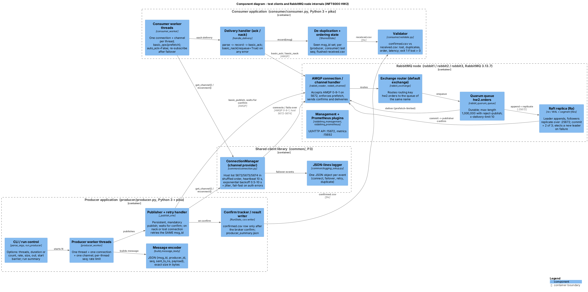
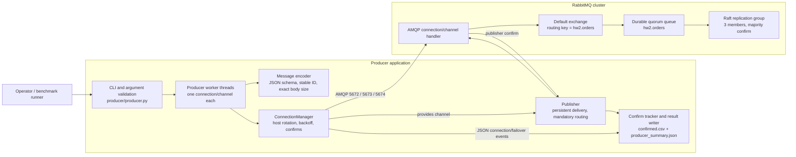

# C4 Level 3 - Component Diagram

The full component view covers both test clients, the shared client library and the internals of one RabbitMQ node, as the assignment asks ("Exchange Routers, Quorum Queues, Connection Handlers" on the broker side; "Retry Handlers, Channel Pools" on the client side). Every client component is named after the function or class that implements it.

- **Source (C4-PlantUML):** [`component-diagram.puml`](component-diagram.puml)
- **Rendered:** `component-diagram.png`



| Diagram component | Code |
|---|---|
| CLI / run control | `producer/producer.py`: `parse_args`, `run_producer` |
| Producer worker threads | `producer_worker` (one connection and channel per thread) |
| Message encoder | `build_message_body` |
| Publisher + retry handler | `_publish_one` (retries the same `msg_id` after a nack or a lost connection) |
| Confirm tracker / result writer | `RunStats`, `confirmed.csv`, `producer_summary.json` |
| ConnectionManager (channel provider) | `common/connection.py` - plays the role of the "channel pool": one managed channel per thread, host rotation, backoff |
| JSON-lines logger | `common/logging_setup.py` |
| Consumer worker threads | `consumer/consumer.py`: `consumer_worker` |
| Delivery handler (ack / nack) | `handle_delivery` |
| De-duplication + ordering state | `SharedState` |
| Validator | `consumer/validate.py` |
| Broker components | RabbitMQ 3.13.7 internals; queue arguments and policy from `scripts/up.sh` |

---

## Producer path in detail (P3)

This component view shows the P3 producer path and its RabbitMQ publishing
destination. The producer uses the shared connection manager so P4 can reuse
the same host rotation and reconnect behavior. The consumer implementation
itself remains P4's responsibility.

## Mermaid view



## PlantUML source

The Mermaid view above is the readable rendering. This source is kept alongside
the project so it can also be rendered with the C4-PlantUML library.

```plantuml
@startuml component-diagram
!include https://raw.githubusercontent.com/plantuml-stdlib/C4-PlantUML/v2.11.0/C4_Component.puml

LAYOUT_LEFT_RIGHT()
title C4 Component Diagram - Producer and RabbitMQ Publishing Path (P3)

Person(operator, "Operator / benchmark runner", "Starts a producer run and keeps its output")

System_Boundary(system, "Distributed AMQP Messaging Cluster") {
  Container_Boundary(producer, "Producer application (Python / pika)") {
    Component(cli, "CLI and argument validation", "producer.py", "Validates hosts, run mode, rate, queue, and body size")
    Component(workers, "Producer worker threads", "threading", "One worker, connection, and channel per thread")
    Component(encoder, "Message encoder", "JSON", "Builds contract message with stable msg_id and exact byte size")
    Component(manager, "ConnectionManager", "common/connection.py", "Rotates hosts, retries transient failures with backoff, enables confirms for publisher")
    Component(publisher, "Publisher", "Pika BlockingChannel", "Passively checks queue; publishes persistent mandatory messages")
    Component(results, "Confirm tracker and result writer", "CSV / JSON", "Writes confirmed.csv and producer_summary.json; emits JSON logs")
  }

  Container_Boundary(cluster, "RabbitMQ 3-node cluster") {
    Component(handler, "AMQP connection and channel handler", "RabbitMQ", "Accepts client connections on host ports 5672-5674")
    Component(exchange, "Default exchange", "RabbitMQ", "Routes by queue name")
    Component(queue, "hw2.orders quorum queue", "RabbitMQ / Raft", "Durable queue; publisher confirms require a quorum")
    Component(raft, "Raft replica group", "3 members", "Replicates committed queue entries to a majority")
  }
}

Rel(operator, cli, "Runs")
Rel(cli, workers, "Starts configured workers")
Rel(workers, encoder, "Creates one logical message per sequence")
Rel(workers, manager, "Requests a channel")
Rel(manager, handler, "Connects / reconnects", "AMQP 5672 / 5673 / 5674")
Rel(manager, publisher, "Provides confirmed channel")
Rel(publisher, handler, "Publishes persistent message", "AMQP 0-9-1")
Rel(handler, exchange, "Routes")
Rel(exchange, queue, "Routes by hw2.orders")
Rel(queue, raft, "Replicates log entries")
Rel(handler, publisher, "Returns publisher confirm")
Rel(publisher, results, "Records confirmed ID and timestamps")
Rel(manager, results, "Logs connect and failover events", "JSON lines")

SHOW_LEGEND()
@enduml
```

## Component responsibilities

| Component | Responsibility |
|---|---|
| CLI | Parses and validates options; makes count and duration modes mutually exclusive. |
| Producer workers | Enforce per-thread sequence and rate limits; stop starting publishes at the duration deadline. |
| Message encoder | Creates the JSON contract, unique per-run producer IDs, stable message IDs, and exact-size bodies. |
| ConnectionManager | Owns one connection/channel per thread, confirms configuration, host rotation, and reconnect backoff. |
| Publisher | Passively verifies the pre-existing queue, uses the default exchange, and retries ambiguous publishes with the same ID. |
| Confirm tracker/result writer | Records only confirmed messages and writes end-of-run counters and latency percentiles. |
