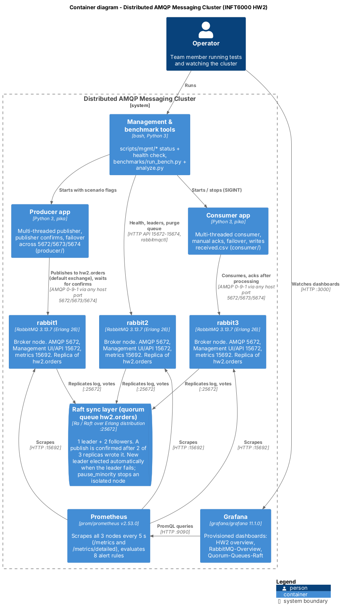
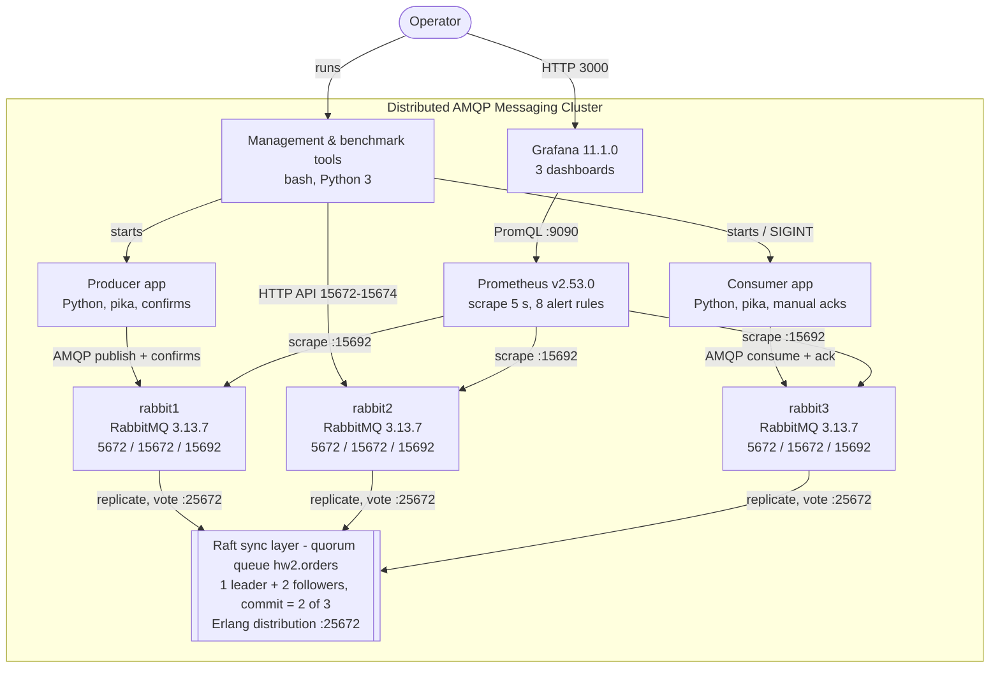

# C4 Level 2 - Container Diagram

Shows the runtime containers of the system and how they talk to each other: the three RabbitMQ nodes, the Raft sync layer that replicates the quorum queue, the monitoring stack, the test clients and the management/benchmark tools.

- **Source (C4-PlantUML):** [`container-diagram.puml`](container-diagram.puml) - render with https://www.plantuml.com/plantuml or `java -jar plantuml.jar -tpng container-diagram.puml`
- **Rendered:** `container-diagram.png` (use this one in the report)
- A Mermaid copy is below so GitHub shows it without tools.

## Every element maps to the code

| Diagram element | Where it is defined | Ports / values in the diagram |
|---|---|---|
| rabbit1, rabbit2, rabbit3 | `docker-compose.yml` services, `rabbitmq/rabbitmq.conf` (`classic_config`) | AMQP 5672, UI/API 15672, metrics 15692 (inside `amqp-net`); host 5672-5674 / 15672-15674 |
| Raft sync layer | quorum queue `hw2.orders` declared in `scripts/up.sh` (`x-queue-type=quorum`, group size 3); `cluster_partition_handling = pause_minority` | Erlang distribution 25672 |
| Prometheus | `docker-compose.yml` service `prometheus`, `monitoring/prometheus/prometheus.yml`, `monitoring/prometheus/rules/rabbitmq-alerts.yml` | scrape 15692 every 5 s, UI 9090 |
| Grafana | `docker-compose.yml` service `grafana`, `monitoring/grafana/provisioning/`, `monitoring/grafana/dashboards/*.json` | 3000, datasource `http://prometheus:9090` |
| Management & benchmark tools | `scripts/mgmt/*`, `benchmarks/run_bench.py`, `benchmarks/analyze.py` | HTTP API 15672-15674, Prometheus 9090 |
| Producer app | `producer/` (CLI in `docs/CONTRACT.md` section 3) | host ports 5672-5674 |
| Consumer app | `consumer/` (CLI in `docs/CONTRACT.md` section 4) | host ports 5672-5674 |

If a port, service or container name changes in `docker-compose.yml`, update this diagram and the Deployment diagram.

## Mermaid version

