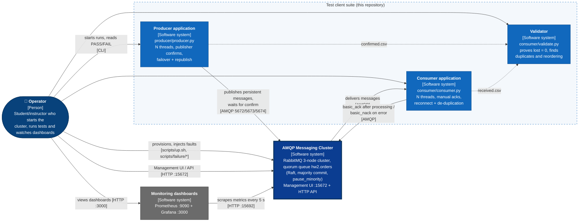

# C4 Level 1 - System Context

Who and what interacts with the **AMQP Messaging Cluster**. Every box below is a real, runnable
part of this repository, so the diagram can be checked against the code (rubric: "precisely align
with the code, cluster scripts, and management topology").


## Elements (and where to verify them)

| Element | Type | What it is | Verify in |
|---|---|---|---|
| Operator | Person | Starts the cluster, runs test clients, injects faults, reads dashboards | `README.md`, `scripts/` |
| Producer application | System | Multi-threaded publisher: publisher confirms, failover, republish with the same `msg_id` | `producer/producer.py`, `common/connection.py` |
| Consumer application | System | Multi-threaded consumer: manual acks, prefetch, reconnect, de-duplication | `consumer/consumer.py`, `common/connection.py` |
| Validator | System | Joins `confirmed.csv` and `received.csv`; proves lost = 0; reports duplicates and reordering | `consumer/validate.py` |
| AMQP Messaging Cluster | System | 3-node RabbitMQ cluster (`rabbit1..3`), quorum queue `hw2.orders`, Management UI/API | `docker-compose.yml`, `rabbitmq/rabbitmq.conf`, `scripts/up.sh` |
| Monitoring dashboards | System | Prometheus (:9090) scraping `rabbitN:15692`, Grafana (:3000) dashboards | `docker-compose.yml`, `monitoring/` |

## Relationships

| From -> To | Protocol / port | Meaning |
|---|---|---|
| Producer -> Cluster | AMQP 5672 / 5673 / 5674 | Persistent publish (`delivery_mode=2`, `mandatory=True`) and wait for the publisher confirm |
| Cluster -> Consumer | AMQP | Delivery of messages from `hw2.orders` (prefetch-limited) |
| Consumer -> Cluster | AMQP | `basic_ack` after the row is written; `basic_nack(requeue=True)` on error |
| Producer -> Validator | file `confirmed.csv` | The ids the broker confirmed |
| Consumer -> Validator | file `received.csv` | The ids that were actually delivered (duplicates included) |
| Monitoring -> Cluster | HTTP 15692 | Prometheus scrapes metrics every 5 s |
| Operator -> Cluster | HTTP 15672 / scripts | Management UI/API; `up.sh`; `scripts/failure/run_scenario.sh` (docker kill / network disconnect) |
| Operator -> Monitoring | HTTP 3000 | Grafana dashboards |
| Operator -> clients | CLI | Starts runs; reads the validator's PASS/FAIL |

Out of scope at this level (shown in the other C4 levels): the Raft replication layer between nodes
(Container diagram, port 25672), internal broker components (Component diagram), host ports and
volumes (Deployment diagram).

## Mermaid source



## PlantUML source (C4-PlantUML)

```plantuml
@startuml context-diagram
!include https://raw.githubusercontent.com/plantuml-stdlib/C4-PlantUML/v2.11.0/C4_Context.puml

title C4 System Context - Distributed AMQP Messaging Cluster

Person(operator, "Operator", "Starts the cluster, runs tests, injects faults, reads dashboards")

System(producer, "Producer application", "producer/producer.py - N threads, publisher confirms, failover + republish")
System(consumer, "Consumer application", "consumer/consumer.py - N threads, manual acks, reconnect + de-duplication")
System(validator, "Validator", "consumer/validate.py - proves lost = 0, finds duplicates and reordering")
System(cluster, "AMQP Messaging Cluster", "RabbitMQ 3 nodes, quorum queue hw2.orders (Raft), Management UI/API")
System_Ext(monitoring, "Monitoring dashboards", "Prometheus :9090 + Grafana :3000")

Rel(operator, producer, "Starts runs", "CLI")
Rel(operator, consumer, "Starts runs", "CLI")
Rel(operator, validator, "Reads PASS/FAIL", "CLI")
Rel(operator, cluster, "Provisions, injects faults, Management UI", "scripts, HTTP 15672")
Rel(operator, monitoring, "Views dashboards", "HTTP 3000")
Rel(producer, cluster, "Publishes persistent messages, waits for confirm", "AMQP 5672/5673/5674")
Rel(cluster, consumer, "Delivers messages", "AMQP")
Rel(consumer, cluster, "basic_ack after processing / basic_nack on error", "AMQP")
Rel(producer, validator, "confirmed.csv", "file")
Rel(consumer, validator, "received.csv", "file")
Rel(monitoring, cluster, "Scrapes metrics every 5 s", "HTTP 15692")
@enduml
```
