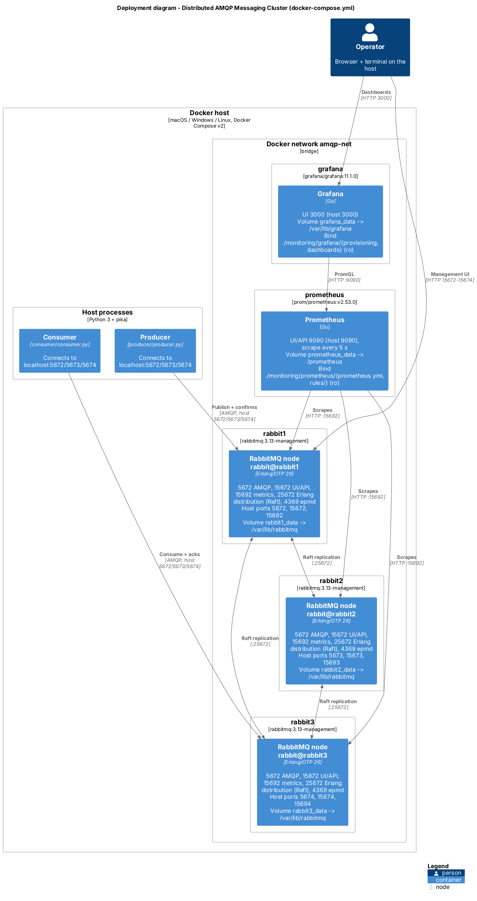
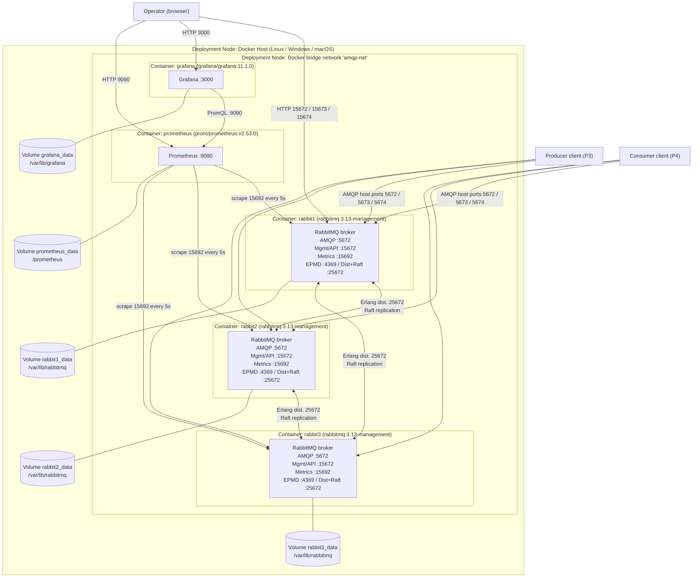

# C4 Level 4 - Deployment Diagram (owner: P1)

Shows the network topology, designated ports, and persistent volume mappings of the stack defined in `docker-compose.yml`. Render with any Mermaid viewer (GitHub renders it automatically) or paste the PlantUML version into https://www.plantuml.com/plantuml.


**Rendered C4 diagram (with volumes and host port mappings):** `deployment-diagram.png`, source [`deployment-diagram.puml`](deployment-diagram.puml). Every port and volume in it is copied from `docker-compose.yml`.


## Mermaid version



## Host-to-container port mapping

| Container | Host port -> Container port | Purpose |
|---|---|---|
| rabbit1 | 5672 -> 5672, 15672 -> 15672, 15692 -> 15692 | AMQP, Management, Metrics |
| rabbit2 | 5673 -> 5672, 15673 -> 15672, 15693 -> 15692 | AMQP, Management, Metrics |
| rabbit3 | 5674 -> 5672, 15674 -> 15672, 15694 -> 15692 | AMQP, Management, Metrics |
| prometheus | 9090 -> 9090 | Prometheus UI / query API |
| grafana | 3000 -> 3000 | Dashboards |

Inter-node traffic (EPMD 4369, Erlang distribution/Raft 25672) stays inside `amqp-net` and is **not** published to the host.

## Volume mappings

| Volume | Mounted at | Content |
|---|---|---|
| `rabbit1_data` / `rabbit2_data` / `rabbit3_data` | `/var/lib/rabbitmq` | Raft log, message store, node metadata |
| `prometheus_data` | `/prometheus` | Time-series database |
| `grafana_data` | `/var/lib/grafana` | Grafana state |
| bind `./rabbitmq/rabbitmq.conf`, `./rabbitmq/enabled_plugins` (read-only) | `/etc/rabbitmq/...` | Broker configuration |
| bind `./monitoring/...` (read-only) | `/etc/prometheus/...`, `/etc/grafana/...` | Monitoring configuration |

## PlantUML (C4-PlantUML) version

```plantuml
@startuml
!include https://raw.githubusercontent.com/plantuml-stdlib/C4-PlantUML/v2.11.0/C4_Deployment.puml

title Deployment Diagram - Distributed AMQP Messaging Cluster

Person(ops, "Operator", "Uses Management UI and Grafana")
System_Ext(prod, "Producer client", "Multi-threaded, publisher confirms")
System_Ext(cons, "Consumer client", "Multi-threaded, manual acks")

Deployment_Node(host, "Docker Host", "Linux") {
  Deployment_Node(net, "Docker network amqp-net", "bridge") {
    Deployment_Node(n1, "rabbit1", "rabbitmq:3.13-management") {
      Container(b1, "RabbitMQ node", "Erlang/OTP", "AMQP 5672, API 15672, metrics 15692, Raft 25672")
    }
    Deployment_Node(n2, "rabbit2", "rabbitmq:3.13-management") {
      Container(b2, "RabbitMQ node", "Erlang/OTP", "AMQP 5672, API 15672, metrics 15692, Raft 25672")
    }
    Deployment_Node(n3, "rabbit3", "rabbitmq:3.13-management") {
      Container(b3, "RabbitMQ node", "Erlang/OTP", "AMQP 5672, API 15672, metrics 15692, Raft 25672")
    }
    Deployment_Node(pr, "prometheus", "prom/prometheus") {
      Container(prom, "Prometheus", "Go", "Scrapes 15692 every 5s, UI 9090")
    }
    Deployment_Node(gr, "grafana", "grafana/grafana") {
      Container(graf, "Grafana", "Go", "Dashboards, UI 3000")
    }
  }
}

Rel(b1, b2, "Raft replication", "Erlang distribution 25672")
Rel(b2, b3, "Raft replication", "Erlang distribution 25672")
Rel(b1, b3, "Raft replication", "Erlang distribution 25672")
Rel(prom, b1, "Scrapes", "HTTP 15692")
Rel(prom, b2, "Scrapes", "HTTP 15692")
Rel(prom, b3, "Scrapes", "HTTP 15692")
Rel(graf, prom, "Queries", "PromQL 9090")
Rel(prod, b1, "Publishes", "AMQP 5672/5673/5674")
Rel(cons, b1, "Consumes", "AMQP 5672/5673/5674")
Rel(ops, b1, "Manages", "HTTP 15672")
Rel(ops, graf, "Views dashboards", "HTTP 3000")
@enduml
```
