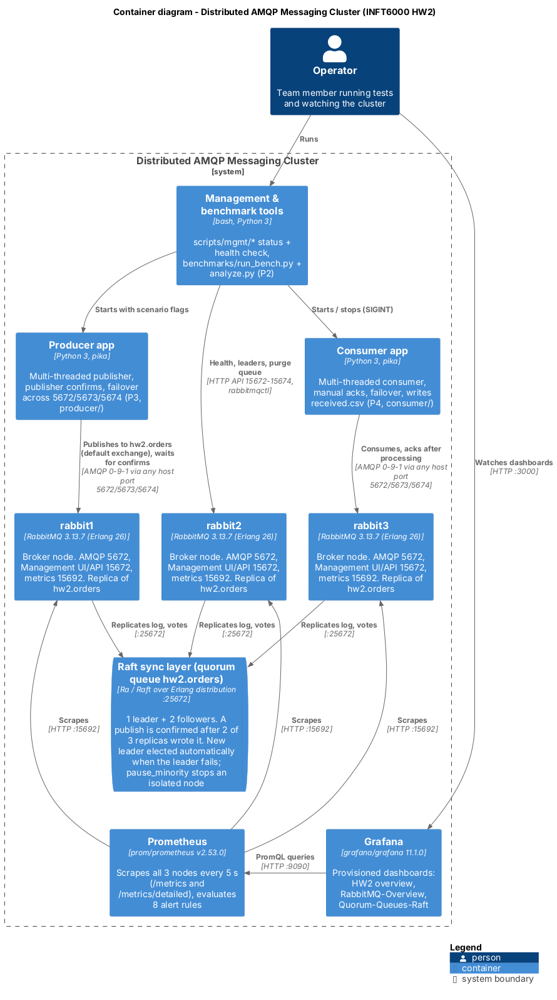

# Design Document - Part P2: Cluster Management and Monitoring

*INFT 6000 - Homework 2. Author: P2. Section 5 of the final report (docs/report/HW2_Group4_Final_Report.docx) is the short version of this document.*

## Cluster Management and Monitoring

### What is built

- Prometheus 2.53.0 scraping all three RabbitMQ nodes every 5 seconds.
- Eight alert rules for node failure, lost majority, memory and disk alarms, backlog, unacked messages, missing consumers and Raft leader elections.
- Grafana 11.1.0 with three dashboards loaded automatically: our own HW2 overview, plus the official RabbitMQ-Overview and RabbitMQ-Quorum-Queues-Raft dashboards.
- Management scripts that show cluster membership, Raft leaders and node health through the CLI and the HTTP API.

### Monitoring pipeline

Each node runs the `rabbitmq_prometheus` plugin on port 15692. Prometheus uses two scrape jobs. The first reads `/metrics`, which gives node-level values: message rates, connections, memory, disk and alarms. The second reads `/metrics/detailed` with the families `queue_coarse_metrics`, `queue_consumer_count` and `ra_metrics`. These are per-queue values such as depth, consumers, Raft term, commit index and commit latency, all with the prefix `rabbitmq_detailed_`, so they never clash with the first job.

The scrape interval is 5 s because RabbitMQ refreshes its own statistics every 5 s, so a shorter interval only repeats values.

Three problems came up while connecting this to the dashboards:

- The official dashboards filter on a `namespace` label that our setup did not have, so every panel was empty. I added the static label `namespace: hw2` to both jobs.
- The detailed endpoint repeats `rabbitmq_identity_info`. A second copy per node breaks the join in one panel of the official Raft dashboard, so the detailed job drops that metric.
- For a quorum queue, the queue depth is reported only by the node that is currently the leader. Every queue panel and alert therefore takes `max()` across the nodes, which stays correct after a leader change.

### Dashboards

The HW2 overview dashboard opens as the Grafana home page and has five rows:

| Row | Panels | Why it matters for HW2 |
|---|---|---|
| Cluster health | nodes up, UP/DOWN per node, queue depth, Raft term, firing alerts, alert table | shows a failure in one glance |
| Message flow | publish / confirm / deliver / ack rate, publish rate per node, redeliveries, connections per node | shows the throughput dip and recovery during a failure, and clients moving to another node |
| Queue | ready and unacked messages, consumers | shows backlog and consumer health |
| Raft | term per node, commit index per node, commit latency | a term step marks a leader election; a restarted node catches up when its commit index meets the others |
| Node resources | memory as % of the watermark, free disk, channels | the limits that trigger RabbitMQ's flow control |

Each node keeps the same colour on every panel. Raft elections are also drawn as annotations on the time series.

[FILL: Figure - screenshot of the HW2 overview under normal load (docs/evidence/p2-02-grafana-normal.png)]

[FILL: Figure - screenshot of the HW2 overview during a leader crash under load, showing the rate dip, the Raft term step and the NodeDown alert (docs/evidence/p2-03-grafana-leader-crash.png)]

### Alert rules

| Alert | Condition | Wait | Severity |
|---|---|---|---|
| RabbitMQNodeDown | a node cannot be scraped | 5 s | critical |
| RabbitMQQuorumLost | fewer than 2 of 3 nodes up | 10 s | critical |
| RabbitMQMemoryAlarm | memory watermark alarm active | - | critical |
| RabbitMQDiskAlarm | free disk below 1 GB | - | critical |
| RabbitMQQueueBacklog | more than 100,000 ready messages | 1 min | warning |
| RabbitMQUnackedHigh | more than 10,000 unacked messages | 2 min | warning |
| RabbitMQNoConsumers | messages waiting and no consumer | 1 min | warning |
| RabbitMQRaftLeaderElection | the Raft term of a queue changed in the last minute | - | info |

The rules have unit tests (`monitoring/prometheus/tests/`) that `promtool` runs: one node down, two nodes down, an election, and a queue without consumers. There is no Alertmanager. Alerts appear on the Prometheus alerts page and in the Grafana alert table, which is enough for a test cluster and keeps the stack small.

[FILL: Figure - Prometheus alerts page while a node is down (docs/evidence/p2-04-alerts-node-down.png)]

### Management tools

| Script | What it does |
|---|---|
| `scripts/mgmt/mgmt_check.py` | Health check through the HTTP API. Tries ports 15672, 15673 and 15674 in turn, so it works while a node is down. Prints each node's memory, disk, alarms and partitions, and each queue's leader and online members. Exits 1 if anything is unhealthy. |
| `scripts/mgmt/cluster_status.sh` | `rabbitmqctl cluster_status` and the alarm check on every running node, asked through whichever container is alive. |
| `scripts/mgmt/quorum_status.sh` | Leader, members and Raft state of every `hw2.*` quorum queue, as plain text that can go into logs. |
| `scripts/mgmt/check_prometheus.sh` | Checks that all 7 scrape targets are up and that per-queue and Raft metrics arrive. |

The shell scripts run on the default bash of macOS (3.2), which has no associative arrays. Only the Python standard library is used, so nothing has to be installed to manage the cluster.

[FILL: mgmt_check.py output with all nodes healthy, and again with one node killed (it should list the stopped node and "2 of 3 members online")]

### Limitations

- Prometheus and Grafana run as single instances, so the monitoring itself is not highly available.
- Metrics have 5 s resolution. Sub-second election times therefore come from P1's failure-test logs, not from Prometheus.
- Alerts are only displayed, not sent anywhere.

