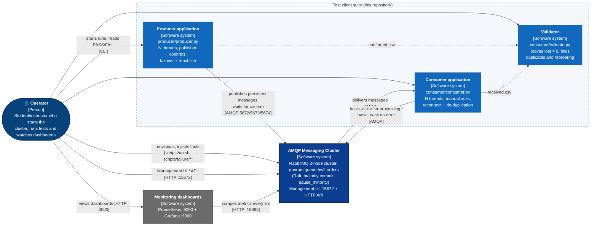
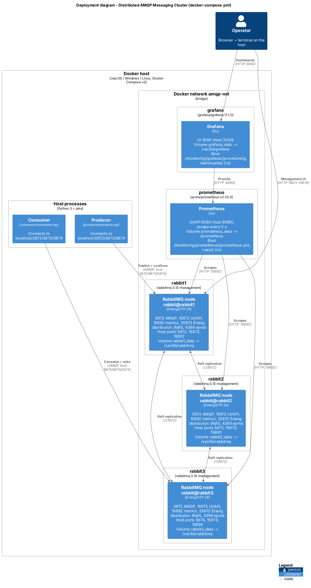
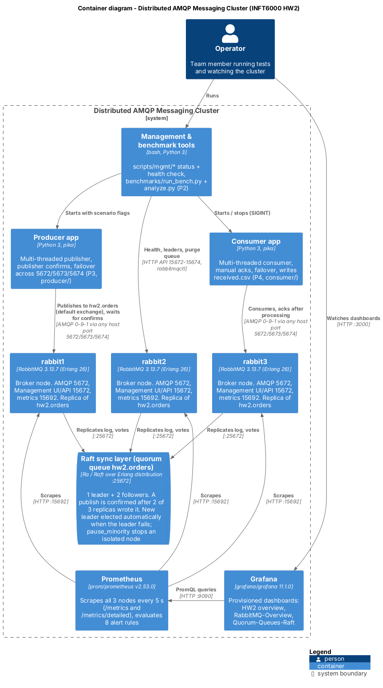
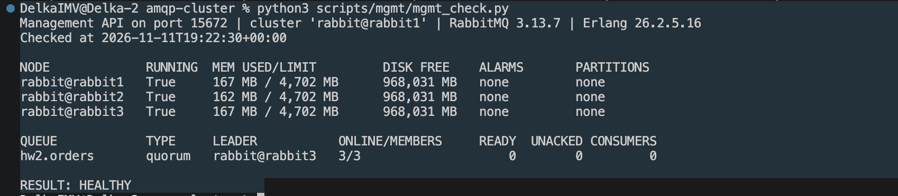
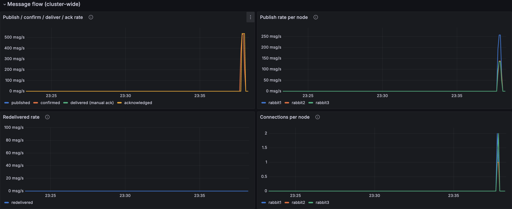
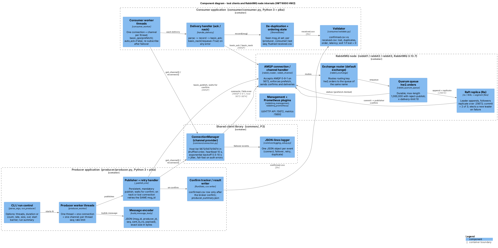
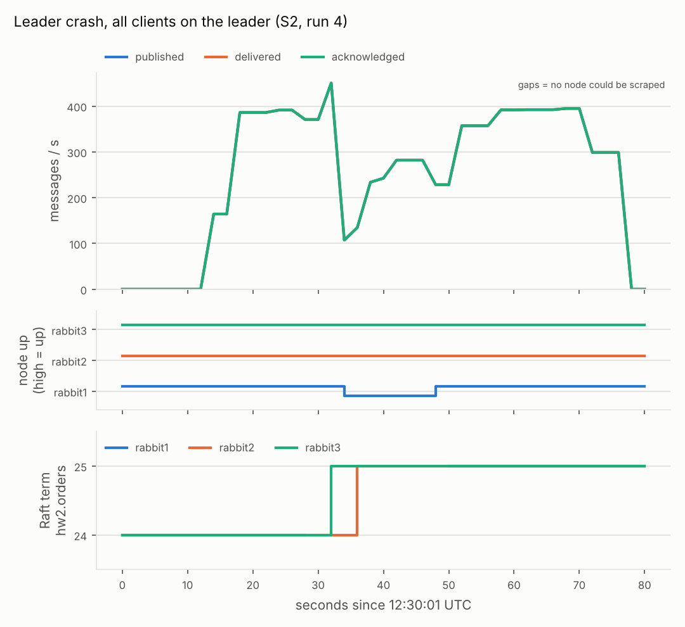
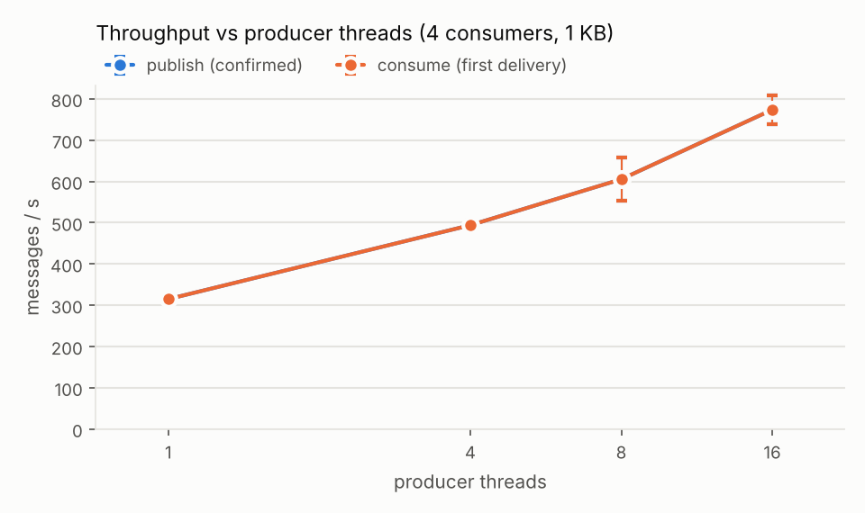
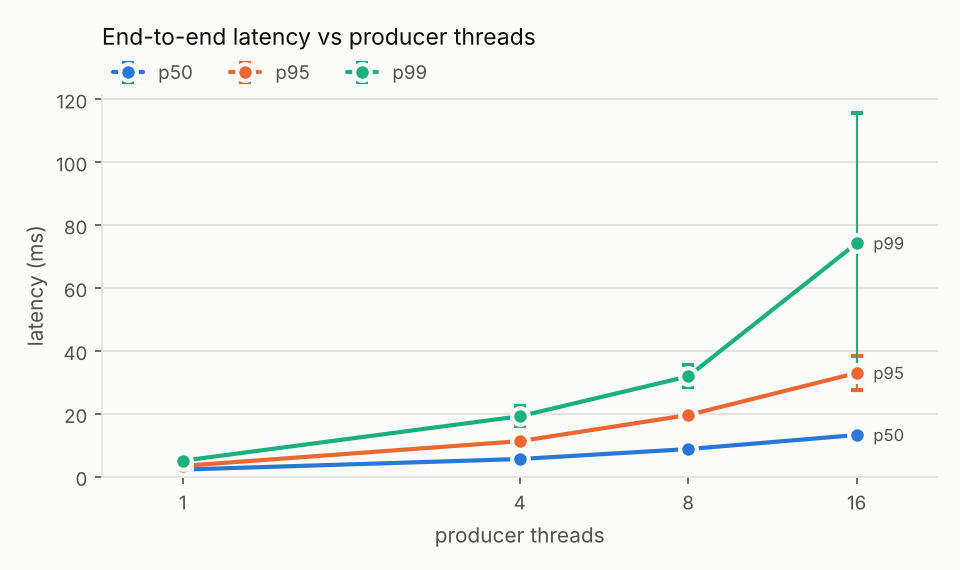

# INFT 6000 Homework 2: Distributed AMQP Messaging Cluster, Management and Validation

**Group 4** - [FILL: student names and IDs] - Repository: [FILL: repository URL] - November 2026

## Summary

We built a three-node RabbitMQ 3.13.7 cluster with one replicated quorum queue (`hw2.orders`, Raft, 3 replicas). One command starts it together with Prometheus and Grafana. We wrote a multi-threaded producer with publisher confirms and failover, a multi-threaded consumer with manual acknowledgements and de-duplication, and a validator that compares what the broker confirmed with what the consumer received.

We ran the clients under load while killing a follower, killing the leader, cutting a node off the network, restarting all nodes one by one, and stopping two nodes at once. In 24 runs the broker confirmed 467,287 messages and the validator found none missing. A new leader was usually elected within half a second. A 50,000-message backlog survived a stop of the whole cluster. In 33 benchmark runs one producer thread reached about 315 msg/s and 16 threads reached 774 msg/s, with a median end-to-end latency of 2 to 13 ms.

**Where the numbers come from.** We used two environments, and we always say which one a result comes from:

- **Docker Desktop on our Mac** (the real Docker Compose deployment): health and monitoring checks, a smoke test and a leader crash under load (sections 5 and 8.6).
- **A native test cluster**: RabbitMQ 3.13.7 with our own `rabbitmq.conf` and `enabled_plugins`, three nodes as separate processes in their own network namespaces on a 2-vCPU Linux machine. The `docker` commands in our scripts (`kill`, `start`, `network disconnect`) were mapped onto these processes. The 24-run failure campaign, the persistence test and all benchmarks ran here (sections 8.3 to 8.5 and 9; Appendix C).

## 1. Introduction and System Context

Our goal is a message broker that keeps every confirmed message when a node fails, and a way to prove this with measurements. The table lists the guarantees and where each one is tested.

| Guarantee | Mechanism | Evidence |
|---|---|---|
| A confirmed message is never lost | Publisher confirms + Raft majority commit (2 of 3 nodes on disk) | Validator `lost = 0` in every run (8.4) |
| One node failure does not stop the system | Quorum queue with 3 members, automatic leader election, client failover | Scenarios S1 to S4 (8.3) |
| No split brain under a partition | `cluster_partition_handling = pause_minority` | Partition scenario S3 |
| Each message is processed once | Manual acks + de-duplication by `msg_id` | Consumer design (7), duplicates in 8.4 |
| Data survives a stop of the whole cluster | Durable queue, persistent messages, Raft log on disk | Persistence test (8.5) |

{width=6.0}

The operator starts the cluster (`scripts/up.sh`), injects faults (`scripts/failure/run_scenario.sh`), runs the clients and watches the dashboards. The producer publishes persistent messages and waits for broker confirms. The consumer receives them with manual acknowledgements. Both clients write CSV files, and the validator compares them.

## 2. Technology Stack and Design Decisions

| Layer | Choice | Why |
|---|---|---|
| Broker | RabbitMQ 3.13.7 (`rabbitmq:3.13-management`) | Native clustering and quorum queues based on Raft |
| Provisioning | Docker Compose v2 + `scripts/up.sh` | One command starts 3 nodes, Prometheus and Grafana and declares the queue |
| Peer discovery | `classic_config` (fixed node list) | Simple and deterministic, no extra service |
| Management | Management plugin (UI, HTTP API), `rabbitmqctl`, our scripts in `scripts/mgmt/` | Our scripts keep working while a node is down |
| Monitoring (bonus) | `rabbitmq_prometheus` -> Prometheus 2.53.0 -> Grafana 11.1.0 | Built-in exporter, alert rules, dashboards loaded from files |
| Clients | Python 3, pika 1.3+, one `BlockingConnection` per thread | pika connections are not thread-safe, so each thread has its own |
| Logging and analysis | JSON-line logs; pandas and matplotlib | Machine-readable events; percentiles and charts from CSV files |

Three decisions shaped the design:

- **Default exchange, one queue.** The producer publishes to the default exchange with routing key `hw2.orders`. There is no routing logic, so the tests focus on replication and failover.
- **Synchronous confirms.** Each producer thread waits for the confirm of one message before it sends the next. This is slower than batched confirms, but the retry rule becomes simple: only the message in flight can be unconfirmed, and it is resent with the same `msg_id`. We get more throughput by adding threads.
- **Consistency over availability.** A quorum queue refuses writes when no majority exists. We accept a short stop during a failure so that no confirmed message is lost.

All interfaces between the four parts (queue name, ports, message format, CSV columns, command-line flags) are fixed in `docs/CONTRACT.md`.

## 3. Cluster Topology and Consensus Configuration

The cluster has three equal RabbitMQ nodes (`rabbit@rabbit1` to `rabbit@rabbit3`) on the Docker network `amqp-net`. They find each other through a fixed list in `rabbitmq/rabbitmq.conf` and share one Erlang cookie, so the cluster forms by itself when the containers start.

**Quorum queue.** `scripts/up.sh` declares `hw2.orders` with `x-queue-type = quorum`, `x-quorum-initial-group-size = 3` and `x-delivery-limit = 10`. The queue is one Raft group with a leader and two followers. A message is committed, and only then confirmed, when a majority has written it to its log: floor(3/2) + 1 = 2 nodes. So the cluster survives one failed node. When the leader fails, the followers stop receiving its heartbeats, one of them starts an election and wins with two votes, and the clients reconnect to a surviving node.

| Setting | Value | Purpose |
|---|---|---|
| Policy `hw2-quorum` on `^hw2\.` | `max-length = 1,000,000`, `overflow = reject-publish` | A full queue rejects new messages with a nack instead of dropping old ones |
| `x-delivery-limit` | 10 | A message that keeps failing cannot loop forever |
| `cluster_partition_handling` | `pause_minority` | A node that sees fewer than half of the nodes stops serving (no split brain) |
| `heartbeat` | 10 s | Dead client connections are found within seconds |
| Memory / disk limits | 60 % of RAM; 1 GB free disk | Flow control before memory or disk runs out |
| `quorum_queue.continuous_membership_reconciliation` | true | The queue goes back to 3 members after a node returns |

## 4. Deployment Architecture

{width=3.3}

| Service | Host ports | Purpose |
|---|---|---|
| rabbit1 / rabbit2 / rabbit3 | 5672 / 5673 / 5674 | AMQP 0-9-1 for the clients |
| rabbit1 / rabbit2 / rabbit3 | 15672 / 15673 / 15674 | Management UI and HTTP API |
| rabbit1 / rabbit2 / rabbit3 | 15692 / 15693 / 15694 | Prometheus metrics |
| all RabbitMQ nodes | not published (25672, 4369) | Erlang distribution (clustering, Raft replication) and epmd |
| prometheus / grafana | 9090 / 3000 | Metrics UI and API / dashboards |

Each node keeps its Raft log and message store on its own volume (`rabbit1_data` to `rabbit3_data`, mounted at `/var/lib/rabbitmq`). Prometheus and Grafana also have volumes, and all configuration files are mounted read-only from the repository. `./scripts/up.sh` starts everything, waits until the three nodes are healthy (`rabbitmq-diagnostics -q check_running`) and clustered, declares the queue and policy, and prints the Raft status. `./scripts/down.sh --purge` removes everything, including the volumes.

## 5. Cluster Management and Monitoring

{width=3.1}

**Management and health checks.** Every RabbitMQ container has a Docker healthcheck. `scripts/mgmt/mgmt_check.py` checks node health, alarms, partitions and the queue's leader and online members through the HTTP API. It tries ports 15672 to 15674 in turn, so it still works while a node is down, and exits 1 if anything is wrong. `cluster_status.sh` and `quorum_status.sh` give the same view through the command line. Figure 4 shows the check on our Docker cluster.



**Monitoring pipeline (bonus).** Each node runs the `rabbitmq_prometheus` plugin on port 15692. Prometheus scrapes all three nodes every 5 s with two jobs: `/metrics` for node values (message rates, connections, memory, disk, alarms) and `/metrics/detailed` for per-queue values (depth, consumers, Raft term, commit index and commit latency). Grafana loads its data source and three dashboards from files: our "HW2 - RabbitMQ cluster overview" (the home page) and the official RabbitMQ-Overview and RabbitMQ-Quorum-Queues-Raft dashboards. We had to fix three things to make the dashboards work: the official dashboards need a `namespace` label (we add `namespace: hw2`), the detailed endpoint repeats `rabbitmq_identity_info` (we drop it there), and only the leader reports the depth of a quorum queue (so every queue panel takes `max()` across nodes).

**Alert rules.** `monitoring/prometheus/rules/rabbitmq-alerts.yml` has eight rules. Four `promtool` unit tests pass for them. Alerts are shown in Prometheus and Grafana; we did not add Alertmanager notifications.

| Alert | Fires when |
|---|---|
| RabbitMQNodeDown / RabbitMQQuorumLost (critical) | a node cannot be scraped for 5 s / fewer than 2 of 3 nodes are up for 10 s |
| RabbitMQMemoryAlarm / RabbitMQDiskAlarm (critical) | a memory or disk alarm is raised |
| RabbitMQQueueBacklog / UnackedHigh / NoConsumers (warning) | more than 100,000 ready or 10,000 unacked messages, or messages wait with no consumer |
| RabbitMQRaftLeaderElection (info) | the Raft term of a queue changes |

**Verification on Docker.** On our Mac with Docker Desktop (11 November 2026) we checked the monitoring stack end to end with `scripts/mgmt/check_monitoring.py`, a read-only script. It reported:

- 7 of 7 scrape targets UP (the Prometheus targets page showed the same);
- all 8 alert rules loaded with `health=ok`;
- the three metrics the assignment asks for: node health (3 nodes up), queue depth, and message, confirm and deliver rates;
- Grafana 11.1.0 running, with the provisioned Prometheus data source and all three dashboards;
- all 22 panel queries of the HW2 dashboard returning data when sent through Grafana to Prometheus.

The result was **MONITORING CHECK: PASS**. Figure 5 shows the HW2 dashboard during a message-processing run. The publish, confirm, deliver and acknowledge rates rise together to about 500 msg/s, the traffic is spread over all three nodes, and nothing is redelivered. In the same run the queue depth peaked at about 2,700 messages and returned to zero once the four consumers attached.



On the native test cluster, Grafana could not be downloaded, so there we ran all 69 dashboard queries directly against Prometheus (no errors) and used the same data for Figure 7.

## 6. Client Architecture: Producer and Shared Library



**Shared library (`common/`).** `ConnectionManager` owns one connection and one channel. It shuffles the host list (`localhost:5672,5673,5674`), connects with a 10 s heartbeat, and after a failure moves to the next host with exponential backoff (0.5 s, doubling up to 10 s, plus random jitter). Wrong credentials or missing permissions fail at once instead of retrying forever. Every connect, failure and failover is logged as one JSON line.

**Producer (`producer/producer.py`).** `--threads N` starts N workers. Each worker has its own `ConnectionManager` with publisher confirms enabled, so threads share no pika objects. A worker builds a JSON message `{msg_id, producer_id, seq, sent_ts_ns, payload}` padded to exactly `--size` bytes and publishes it with `delivery_mode = 2` (persistent) and `mandatory = True`. It then waits for the broker's answer:

- **Confirm:** the message is written to `confirmed.csv` with its send and confirm times.
- **Nack** (for example, the queue is full): the worker reconnects and tries again, up to `--nack-retry-limit` times (default 5).
- **Connection lost before the confirm:** the worker reconnects to another node and sends the same message again with the same `msg_id`. The broker may already have stored the first copy, so this can create a duplicate, which the consumer removes. It can never cause a loss.

`--duration` or `--count`, `--rate` and `--size` make the producer usable as a load generator. At the end it writes `producer_summary.json` (sent, confirmed, nacked, republished, reconnects, confirm-latency percentiles).

## 7. Consumer, Acknowledgements, Ordering and Persistence

**Consumer (`consumer/consumer.py`).** `--threads N` starts N workers, each with its own connection, `basic_qos(prefetch_count)` and `auto_ack = False`. For each delivery the handler parses the message, checks its `msg_id` against the set of IDs already seen, writes one row to `received.csv` and flushes the file, and only then sends `basic_ack`. If anything fails, it sends `basic_nack(requeue = True)`, and the queue's delivery limit stops a broken message after 10 attempts. On any connection error the worker reconnects and subscribes again; unacked messages go back to the queue. On SIGINT or SIGTERM the consumer finishes the current message, writes `consumer_summary.json` and exits 0.

**Duplicates and idempotency.** RabbitMQ delivers at least once. If a consumer's connection breaks after it processed a message but before the ack arrived, the message is delivered again with `redelivered = true`. A producer retry can also create a second copy. The consumer records every delivery as evidence, but processes each `msg_id` only once and acks the duplicates. The set of seen IDs is kept in memory, so it is lost if the consumer process itself restarts (see section 10).

**Ordering.** A queue delivers messages to one consumer in publish order, except for redeliveries. With several competing consumers there is no global order, so our pass/fail check is "out-of-order per consumer": a first delivery whose `seq` is lower than one the same consumer already received from the same producer. It must be 0.

**Validator (`consumer/validate.py`).** Lost = confirmed `msg_id`s that never arrived. It also reports duplicates, out-of-order counts and end-to-end latency, and exits 1 if anything was lost or nothing was confirmed, so an empty run cannot pass. `scripts/p4/validator_demo.sh` shows that it finds exactly the 2 lost, 3 duplicated and 1 reordered messages we planted.

**Persistence and unit tests.** `scripts/p4/persistence_test.sh` publishes 50,000 persistent messages, stops and restarts all three nodes, and then drains and validates the queue (section 8.5). 32 unit tests (`python3 -m pytest common producer consumer`) cover message sizing, retries with the same `msg_id`, host rotation, ack-after-write, nack on errors, de-duplication, ordering and the validator. All 32 pass.

## 8. Failure Recovery Policies and Chaos Testing

### 8.1 Recovery policies

| Failure | Detection | Automatic reaction | Confirmed data | Recovery |
|---|---|---|---|---|
| Follower crash | Leader gets no Raft replies from it | Leader keeps committing with the other follower | Safe: on two disks | Restart; the node catches up from the log |
| Leader crash | Followers miss the leader's heartbeats | A follower wins an election; clients reconnect elsewhere | Safe: the new leader has all committed entries | Restart; the old leader returns as a follower |
| One node isolated | It sees only 1 of 3 nodes | `pause_minority` pauses it; the majority elects a leader if needed | Safe: the minority cannot commit | Heal the network; the node catches up |
| Two nodes down | No majority | Nothing is confirmed; the last node pauses itself | Safe, but not available (CP) | Bring one node back |
| Rolling restart | Planned | One node at a time | Safe | Wait for 3 running nodes before the next restart |

On the client side the policy is the one from sections 6 and 7: persistent messages, publisher confirms, resend with the same `msg_id` when a confirm is missing, manual acks, and reconnection to another node with backoff.

### 8.2 Method

`scripts/p4/chaos_run.sh <scenario> <run>` starts the consumer (4 threads, prefetch 100) and the producer (4 threads at 100 msg/s each, 1 KB messages, 60 s; 100 s for the rolling restart). After 15 s it injects the fault with P1's `scripts/failure/run_scenario.sh`, waits until the queue is empty, stops the consumer and runs the validator. Each run keeps its raw files in `results/chaos/<scenario>/run<k>/`.

In runs 1 to 3 the clients pick a node at random, as in normal use, so sometimes no client is on the failed node. In runs 4 to 6 of the crash and partition scenarios **every** client starts on the node that will fail (`TARGET_FAILOVER=1`), so client failover is tested every time. `scripts/qa/quorum_loss_run.sh` adds two nodes down for 20 s (3 runs). Earlier, P1 had run S1 to S3 once each on the Docker stack without load (2026-10-23, `results/failure_S*`): a new leader appeared 55 ms after the leader was killed. Those runs showed recovery, but not data integrity, because no messages were flowing.

### 8.3 Results (native test cluster)

| Scenario | Runs | Leader election | Longest pause in confirms | Cluster complete again | Throughput (msg/s) |
|---|---|---|---|---|---|
| S1 follower crash | 6 | none needed | 0.3 s (targeted) | 6.5 to 9.9 s after restart | 365 to 374 |
| S2 leader crash | 6 | 447 to 964 ms, median 478 ms | 0.2 to 0.3 s (targeted) | 6.9 to 14.9 s after restart | 347 to 363 |
| S3 partition of `rabbit3` | 6 | run 1 (rabbit3 was leader): new leader on the majority side | 6.3 s (run 1), up to 27.9 s (targeted) | 2.6 to 4.5 s after the network returned | 123 (run 1), 207 to 303 |
| S4 rolling restart | 3 | leader moved as nodes restarted | - | 44 to 49 s for all three nodes | 320 to 349 |
| Two nodes down | 3 | new term when the majority returned | 31 to 38 s | 11 s after restart (run 3) | 135 to 152 |

The election time is measured by `run_scenario.sh`, which polls the management API every 200 ms after `docker kill`. The longest pause is the largest gap between two confirms in `confirmed.csv`.

- **A leader crash hardly affects the clients.** Even with all eight client connections on the leader, confirms stopped for at most 0.3 s (Figure 7).
- **A partition is the slowest failure.** Clients on the isolated node only notice it through missed heartbeats, so confirms paused for about 28 s in the targeted runs, and up to 400 prefetched messages were redelivered.
- **Isolating the leader is the worst case.** In run 1 a new leader was elected on the majority side within seconds, but publishes were still routed through the old leader until the isolated node was declared down (Erlang's 60 s `net_ticktime`). Throughput stayed at about a third of normal.
- **Losing the majority stops writes, as designed.** Nothing was confirmed for 31 to 38 s, the producers kept retrying, and everything continued once a second node returned.

{width=4.4}

**Alerts during the faults.** A watcher logged the firing alerts every 5 s. `RabbitMQNodeDown` fired for the right node in all 23 monitored runs. `RabbitMQRaftLeaderElection` fired after every leader crash, rolling restart and quorum loss, and not after a follower crash, where no election happens. `RabbitMQQuorumLost` fired only when two nodes were really down.

### 8.4 Data integrity (native test cluster)

| Scenario | Runs (targeted) | Confirmed | Lost | Duplicates (per run) | Redelivered (per run) | Producer resends (per run) |
|---|---|---:|---:|---|---|---|
| S1 follower crash | 6 (3) | 132,538 | **0** | 0 to 3 | 1 to 4 | 1 to 4 |
| S2 leader crash | 6 (3) | 128,706 | **0** | 0 to 2 | 1 to 3 | 0 to 4 |
| S3 partition | 6 (3) | 79,024 | **0** | 0 to 3 | 100 to 400 | 1 to 4 |
| S4 rolling restart | 3 | 100,952 | **0** | 4 to 11 | 3 to 6 | 6 to 11 |
| Two nodes down | 3 | 26,067 | **0** | 0 to 3 | 0 to 3 | 4 to 5 |
| **Total** | **24** | **467,287** | **0** | | | |

*Generated from `results/chaos/*/run*/validation.json`; the per-run table is printed by `python3 scripts/p4/summarize_chaos.py`.*

All 24 runs passed with **0 lost and 0 out-of-order deliveries per consumer**. Duplicates appeared in 17 runs, mostly where a client lost its connection with a message in flight; each one was recorded, acked and not processed again. In every targeted run all 4 producer threads and all 4 consumer threads reconnected to another node, and each producer thread resent exactly the message it was waiting for. Before the final fixes (Appendix D), we had also run 12 chaos runs (138,896 confirmed messages) and the persistence test on the code as first submitted, again with 0 lost.

As an example, in leader-crash run 5 `quorum_status` showed rabbit2 as leader in Raft term 25 before the crash and rabbit1 as leader in term 26 after it, with the same commit index on all three nodes. The election took 521 ms, and the validator reported 21,810 confirmed, 21,810 received, 0 lost and 2 redelivered duplicates.

### 8.5 Persistence: stop of the whole cluster (native test cluster)

`persistence_test.sh` published 50,000 persistent 256-byte messages with no consumer, stopped all three nodes and started them again. The queue held **50,000 messages before and 50,000 after** the restart. The cluster accepted connections again 21 s after the stop command. The consumer then drained the queue, and the validator reported **50,000 confirmed, 50,000 received, 0 lost, 0 duplicates**.

### 8.6 Tests on Docker Desktop

Before submission we ran the same scripts on the Docker Compose stack on our Mac, with all three RabbitMQ containers healthy and Prometheus and Grafana running. These results are kept apart from the native tables above.

| Test on Docker Desktop | Confirmed / received | Lost | Duplicates | Other checks | Result |
|---|---|---:|---|---|---|
| Smoke test (`smoke.sh`) | 10,000 / 10,000 | **0** | 0 | - | PASS |
| Leader crash under load (`chaos_run.sh leader-crash`) | 23,680 / 23,680 | **0** | 2, not processed twice | 0 order errors per consumer; p95 2.96 ms, max 513.79 ms | PASS |
| `mgmt_check.py`, `check_monitoring.py` | - | - | - | HEALTHY; 7/7 targets, 22/22 panel queries | PASS |

In the leader-crash run the producer and the consumer both exited cleanly after the failover. The raw files of these runs (`confirmed.csv`, `received.csv`, `validation.txt`) belong in `results/docker/` [FILL: copy the smoke and leader-crash result folders from the Mac into results/docker/ before submission].

## 9. Performance Benchmarking (native test cluster)

### 9.1 Setup and method

The benchmarks ran on the 2-vCPU test machine (Appendix C), where the three broker nodes, both clients and Prometheus share two CPUs. The queue is the replicated quorum queue `hw2.orders`; messages are persistent, the producer waits for confirms and the consumer uses manual acks.

`benchmarks/run_bench.py` runs every configuration in `benchmarks/scenarios.yaml` three times. Before each run it waits until all three nodes are up and the queue has 3 of 3 members, then empties the queue. The producer publishes as fast as confirms allow for 60 s. `benchmarks/analyze.py` skips the first 5 s and computes publish throughput (confirmed messages per second), end-to-end latency (receive time minus send time, on one clock) and confirm latency. The configurations are: B1 baseline (1 producer and 1 consumer thread), B2 producer threads 1/4/8/16, B3 message size 256 B/4 KB/64 KB, and B4 prefetch 10/100/500. Unless changed, runs use 4 consumer threads, 1 KB messages and prefetch 100.

All 33 runs completed with no duplicate or undelivered message. As an independent check, the broker's own publish counter from Prometheus agreed with the client numbers within 0.4 % in every configuration.

### 9.2 Results

| Scenario | Producer threads | Size | Prefetch | Publish (msg/s) | Payload (MB/s) | E2E p50 (ms) | E2E p95 (ms) | E2E p99 (ms) | Raft commit (ms) |
|---|---:|---:|---:|---:|---:|---:|---:|---:|---:|
| B1 baseline (1 consumer) | 1 | 1 KB | 100 | 329 ± 23 | 0.34 | 2.3 | 3.9 | 7.0 | 1.9 |
| B2-p1 | 1 | 1 KB | 100 | 315 ± 9 | 0.32 | 2.3 | 3.4 | 5.1 | 1.8 |
| B2-p4 | 4 | 1 KB | 100 | 494 ± 11 | 0.51 | 5.6 | 11.3 | 19.2 | 5.8 |
| B2-p8 | 8 | 1 KB | 100 | 605 ± 53 | 0.62 | 8.8 | 19.6 | 31.9 | 6.0 |
| B2-p16 | 16 | 1 KB | 100 | 774 ± 34 | 0.79 | 13.3 | 33.0 | 74.2 ± 41.6 | 8.3 |
| B3-256B | 4 | 256 B | 100 | 531 ± 22 | 0.14 | 5.5 | 10.8 | 17.9 | 3.9 |
| B3-4KB | 4 | 4 KB | 100 | 445 ± 36 | 1.82 | 6.3 | 11.9 | 23.8 | 8.5 |
| B3-64KB | 4 | 64 KB | 100 | 302 ± 12 | 19.80 | 10.1 | 23.0 | 49.8 | 14.5 |
| B4-q10 | 4 | 1 KB | 10 | 482 ± 10 | 0.49 | 5.6 | 10.8 | 17.8 | 6.4 |
| B4-q100 | 4 | 1 KB | 100 | 487 ± 23 | 0.50 | 5.9 | 12.0 | 21.3 | 5.2 |
| B4-q500 | 4 | 1 KB | 500 | 467 ± 18 | 0.48 | 6.0 | 11.6 | 18.1 | 5.1 |

*Mean of 3 runs; ± is the standard deviation. Consume throughput equalled publish throughput everywhere. Raft commit = mean `rabbitmq_detailed_raft_entry_commit_latency_seconds` of `hw2.orders`. Source: `benchmarks/results/summary.md`; raw data in `benchmarks/results/raw/`.*

{width=4.6}

{width=4.6}

### 9.3 Analysis

**One thread is limited by the confirm round trip.** A single thread reached 315 to 329 msg/s, so one publish cycle took about 3.1 ms. About 2.1 ms of this (the median confirm time) was waiting for the broker: the leader appends the entry, a follower stores it, and the confirm comes back. The broker reported a Raft commit latency of about 1.9 ms. The remaining 1 ms was the Python client building the message and writing the CSV row.

**More threads help, but not linearly.** From 1 to 16 threads, throughput grew only 2.5 times (315 to 774 msg/s), while Raft commit latency rose from 1.8 to 8.3 ms and p99 to 74 ms. More messages in flight let Raft batch more entries per write, but the three Erlang nodes, both clients and Prometheus share two CPUs, so at 16 threads the CPU is the limit. The large spread of p99 at 16 threads (± 42 ms) also shows a saturated machine.

**Message size.** From 256 B to 64 KB the message rate fell from 531 to 302 msg/s, but the payload rate rose from 0.14 to 19.8 MB/s. For small messages the per-message work (confirm, Raft entry, ack) dominates. At 64 KB each message must also be sent to two followers and written to two disks, and the Raft commit latency rose to 14.5 ms.

**Prefetch made no difference at this load** (482, 487 and 467 msg/s). The consumers were never the bottleneck, so a bigger buffer of unacked messages had nothing to absorb. Prefetch has a cost under failures: a consumer cut off by a partition holds up to `prefetch` messages until they are redelivered (section 8.3).

**Failures and throughput.** The chaos runs (4 threads at 100 msg/s each) kept 347 to 374 msg/s through a follower or leader crash and 320 to 349 msg/s through a rolling restart, but only 123 to 303 msg/s during a partition.

## 10. Conclusion, Limitations and Future Work

Our cluster, clients and validator show what the assignment asks for: a confirmed message survives a follower crash, a leader crash, a network partition, a rolling restart, a loss of majority and a stop of the whole cluster. Across 24 failure runs (467,287 confirmed messages), the full-cluster restart and our Docker leader crash, the validator found 0 lost messages and 0 out-of-order deliveries per consumer. Leader elections happened automatically, and the monitoring stack made each failure visible.

Weak points we found:

- **Partitions are slow to resolve.** When the leader was isolated, publishes were still routed through it until it was declared down, and prefetched messages on an isolated consumer waited about 60 s before redelivery. Both come from Erlang's default 60 s `net_ticktime`. A lower value would help, but we did not test it.
- **Synchronous confirms limit each producer thread.** Asynchronous confirms with several messages in flight would be faster, but the retry logic would be harder to get right.
- **De-duplication lives in memory.** If the consumer process restarts, a redelivered message could be processed twice. A persistent store of processed IDs would close this gap.

Limitations of our evaluation:

- All nodes ran on one machine, so Raft never crossed a real network, and partitions were simulated by disconnecting a network interface.
- The failure campaign and the benchmarks ran on the native test cluster, not on Docker. On Docker we repeated the smoke test, a leader crash under load and the monitoring checks with the same outcome, but not the benchmarks, so absolute throughput on Docker was not measured.
- Grafana was checked on Docker only. We did not show an alert firing on Docker; alert firing was observed in Prometheus on the native cluster.
- Credentials and the Erlang cookie are demo values in `.env.example` and `docker-compose.yml`, and there is no TLS.

Future work: run the nodes on three machines or as a Kubernetes StatefulSet, add Alertmanager notifications, try asynchronous confirms and a lower `net_ticktime`, and enable TLS with real secrets.

## Appendix A. How to Reproduce

```
cp .env.example .env
python3 -m pip install -r requirements.txt
./scripts/up.sh                              # cluster, monitoring, queue
python3 -m pytest -q common producer consumer # 32 unit tests
python3 scripts/mgmt/mgmt_check.py           # RESULT: HEALTHY
python3 scripts/mgmt/check_monitoring.py     # MONITORING CHECK: PASS
./scripts/p4/smoke.sh                        # 10,000 messages, 0 lost
./scripts/p4/chaos_run.sh leader-crash 1     # one chaos run (8.2)
python3 scripts/p4/summarize_chaos.py        # per-run table (8.4)
./scripts/p4/persistence_test.sh             # full-cluster restart
python3 benchmarks/run_bench.py              # 33 runs, about 70 min
python3 benchmarks/analyze.py                # tables and charts (9)
./scripts/down.sh --purge
```

Grafana: http://localhost:3000 (admin / admin). Management UI: http://localhost:15672 (admin / admin123). `smoke.sh` and `chaos_run.sh` empty the queue first, and a chaos run with an existing run number replaces that run's folder. Do not run a benchmark and a chaos test at the same time.

## Appendix B. Contributions

The work was divided into four parts of similar size, and each member wrote the report sections about their own part.

| Member | Implementation | Tests and evidence | C4 diagram | Report sections |
|---|---|---|---|---|
| [FILL: name, ID] - cluster and failure injection | `docker-compose.yml`, `rabbitmq.conf`, `enabled_plugins`, `up.sh`, `down.sh`, `scripts/failure/run_scenario.sh` | Idle-cluster runs of S1 to S3 on Docker, `docs/failure-test-plan.md` | Deployment | 3, 4, 8.1 |
| [FILL: name, ID] - management, monitoring, benchmarking | Prometheus config and 8 alert rules, Grafana provisioning and dashboards, `scripts/mgmt/*`, `benchmarks/*`, `docs/CONTRACT.md` | Alert unit tests, monitoring check, 33 benchmark runs | Container | 5, 9, Appendix A |
| [FILL: name, ID] - producer and shared client library | `common/connection.py`, `common/logging_setup.py`, `producer/producer.py` | 12 producer and connection unit tests | Component (producer side) | 2, 6, 10 |
| [FILL: name, ID] - consumer and validation | `consumer/consumer.py`, `consumer/validate.py`, `scripts/p4/*` | 20 consumer and validator unit tests, chaos and persistence runs | System Context | 1, 7, 8.2 to 8.6 |

## Appendix C. Test Environment (native test cluster)

| Item | Value |
|---|---|
| Machine | Linux VM, 2 vCPU (Intel Xeon 2.1 GHz), 7 GB RAM |
| Broker | RabbitMQ 3.13.7 on Erlang/OTP 26.2.5.4, three nodes `rabbit@rabbit1..3`, our `rabbitmq.conf` and `enabled_plugins` unchanged |
| Network and faults | each node in its own network namespace on one bridge, host ports forwarded as in `docker-compose.yml`; the scripts' `docker kill/start/restart` and `docker network disconnect/connect` mapped onto these processes and interfaces |
| Monitoring and clients | Prometheus 2.53.0 with our `prometheus.yml` and rules (no Grafana); Python 3.13, pika 1.4.4 |
| Date | 2026-11-11 |

## Appendix D. Test Execution Log

The full commands and outputs of the native tests are in `docs/QA-REVIEW.md`, section 5. The Docker tests are listed in section 8.6.

| ID | Test (native test cluster, 2026-11-11) | Result |
|---|---|---|
| T1 | `pytest -q common producer consumer` | 32 passed |
| T2-T5 | `up.sh`, `check_prometheus.sh`, `promtool test rules`, `mgmt_check.py`, `quorum_status.sh` | cluster formed; 7/7 targets; 4 rule tests pass; healthy, correct leader |
| T6 | `validator_demo.sh` | planted 2 lost, 3 duplicates, 1 reorder all found; clean run passes |
| T7 | `smoke.sh` | 10,000 confirmed and received, 0 lost |
| T8-T10 | 21 `chaos_run.sh` runs + 3 quorum-loss runs, with an alert watcher | 24 runs, 467,287 confirmed, 0 lost; alerts fired as expected |
| T11 | `persistence_test.sh` | 50,000 before and after a full restart, 0 lost |
| T12 | `run_bench.py` + `analyze.py` | 33 of 33 runs completed |
| E1-E5 | wrong password, missing queue, full queue, all hosts down, too-small message size | each fails fast with a clear error or recovers as designed |

Changes made during the final review (all re-tested above): readable Raft status in logs, macOS-compatible shell scripts, a targeted-failover mode for chaos runs, completed Component and Deployment diagrams, the election alert limited to queues, a quorum-loss test, a fixed `requirements.txt`, the `check_monitoring.py` script, and removal of unrelated files.
